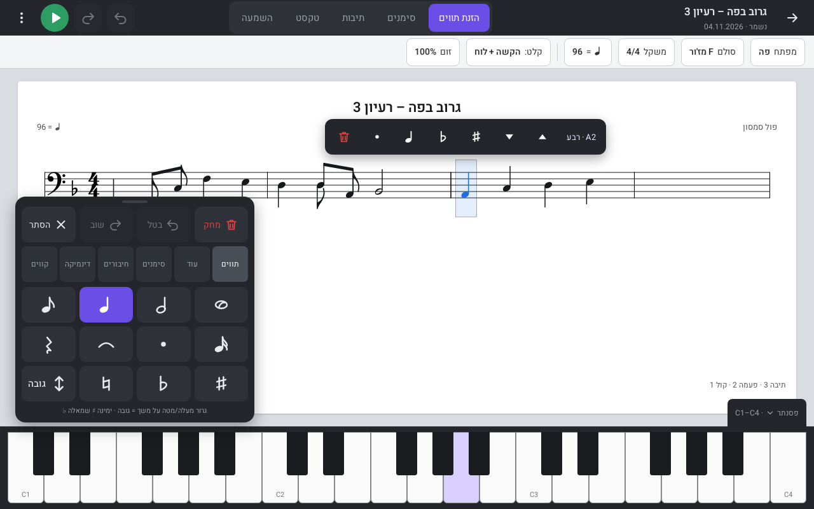
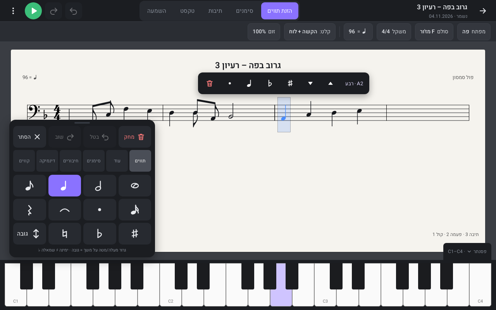

# מחברת בס

מחברת תווים לטאבלט אנדרואיד, בעברית, שעובדת לגמרי בלי אינטרנט — חלופה חינמית לאפליקציות כתיבת תווים בתשלום. בוחרים משך, מקישים או גוררים על הלוח, והתו נחרט מיד. אפשר לשמוע, לשמור מחברת שלמה ולייצא ל-MusicXML, ל-PDF ול-PNG. בלי חשבון, בלי פרסומות ובלי הגבלה על מספר העמודים.

גרסה 3 היא שכתוב מלא של הממשק: מעטפת כהה, דף לבן על שולחן אפור, לוח הזנה צף (Keypad), פסנתר מתקפל וסרגל הקשרי מעל התו הנבחר. האפליקציה בנויה כאתר סטטי (HTML/CSS/JS, בלי build) ואפשר להתקין אותה למסך הבית.

## צילומי מסך





## התקנה בטאבלט אנדרואיד

1. פותחים את האתר בכרום.
2. בתפריט ⋮ בוחרים **התקן אפליקציה** או **הוסף למסך הבית**.
3. אחרי הטעינה הראשונה הכול עובד גם במצב טיסה: עריכה, שמירה, השמעה (סינתזה מקומית) וייצוא.

## מדריך מהיר

- **רעיון חדש**: פה (ברירת מחדל), סול או חמשה כפולה; 4/4, דו מז'ור, ♩=100. המפתח נשמר לכל דף.
- **שלוש דרכים להכניס תו**, וכולן פעילות תמיד:
  1. **גרירה על הלוח**: לוחצים ומחזיקים משך (או גוררים), גוררים למעלה/מטה — כל 14 פיקסלים צעד דיאטוני — וימינה ♯ או שמאלה ♭. מופיעים צל תו ותווית גובה (למשל A2), ובשחרור התו נכנס. הקשה קצרה על משך רק בוחרת אותו. אפשר לכבות את הגרירה בהגדרות.
  2. **פסנתר**: מקש = הגובה המדויק במשך הפעיל. כשתו נבחר, מקש מחליף את הגובה שלו.
  3. **הקשה על החמשה**: ברירת המחדל ("קלט: הקשה + לוח"). אפשר לעבור ל"לוח בלבד" בסרגל.
- **בחירה**: הקשה על תו; לחיצה ארוכה וגרירה (או לחיצה ארוכה על תו שני) לבחירת טווח; בלוח בלבד — הקשה על תיבה, הקשה כפולה לכל השורה. מעל הבחירה מופיע סרגל עם גובה, ▲▼, ♯♭, משך, נקודה ומחיקה.
- **הלוח הצף** נגרר בידית שבראשו, אפשר להסתיר (הסתר) ולהחזיר בכפתור הסגול. המיקום נשמר בנפרד לרוחב ולאורך. ב-portrait הוא נצמד לתחתית.
- **סרגל עליון**: לשוניות הזנת תווים / סימנים / תיבות / טקסט / השמעה, ↶ ↷ תמיד גלויים, ▶ ו-⋮ (ייצוא, הגדרות דף, הגדרות).

## מחוות וקיצורי מקלדת

| פעולה | במסך | במקלדת |
|---|---|---|
| משך | לוח | `1`–`5` (שלמה…16) |
| הפסקה | 𝄽 בלוח | `6` או `R` |
| נקודה / חיבור | · ⁀ | `.` / `T` |
| דיאז / במול / בקר | ♯ ♭ ♮ | `+` / `-` / `=` |
| הוספת תו | לוח, פסנתר, החמשה | `A`–`G` |
| גובה / אוקטבה | ▲▼ | `↑` `↓` / `Ctrl` + חצים |
| מחיקה | 🗑 | `Backspace` |
| בטל / שוב | ↶ ↷, שתי אצבעות / שלוש אצבעות | `Ctrl+Z` / `Ctrl+Shift+Z` |
| העתק / הדבק | סרגל הבחירה | `Ctrl+C` / `Ctrl+V` |
| זום | צביטה (60%–200%) | שבב "זום" |
| גלילה | שתי אצבעות | גלגלת |
| השמעה | ▶ (מהסמן) | רווח |

## ייצוא וגיבוי

- **MusicXML** (לפתיחה ב-MuseScore), **PDF** וקטורי A4 (כמה עמודים), **PNG**: בתפריט ⋮ בעורך.
- **גיבוי JSON** ושחזור (מיזוג או החלפה) בהגדרות. **הנתונים נשמרים רק במכשיר** — כדאי לגבות מדי פעם. קובץ פגום נדחה בלי לשנות כלום.

## הערה על גובה הבס

ההשמעה בגובה הכתוב (concert), בלי הנמכת אוקטבה.

## הרצה מקומית ובדיקות

```
python3 tools/serve.py 4173
npm install
npm test            # שלושה projects: desktop, tablet (1280x800), tablet-portrait (800x1280)
node tools/screenshots.js   # מצלם screenshots/v3-light.png ו-v3-dark.png
```

## רישיון וקרדיטים

MIT © Paul Samson. תלויות: VexFlow ו-Bravura, jsPDF, svg2pdf.js, Heebo — הפירוט והרישיונות ב-`THIRD_PARTY_NOTICES.md`. כל האייקונים בממשק צוירו במיוחד לפרויקט (SVG).
