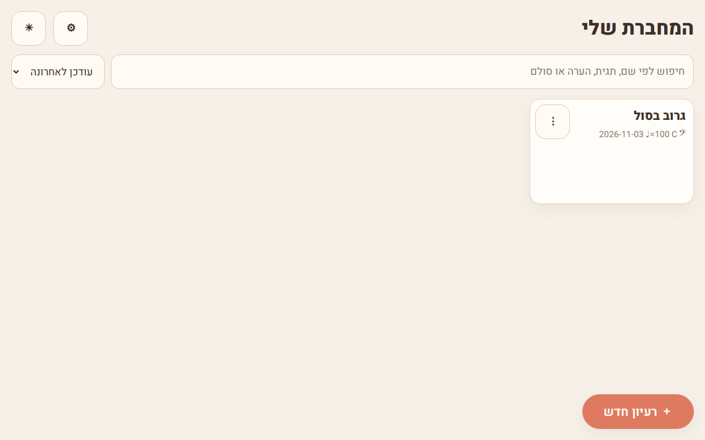
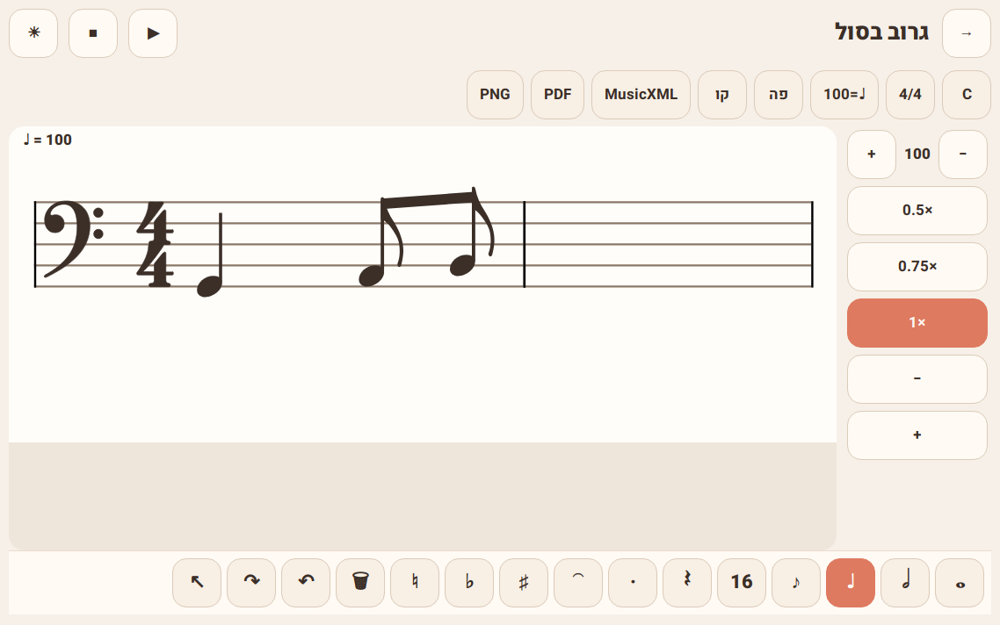
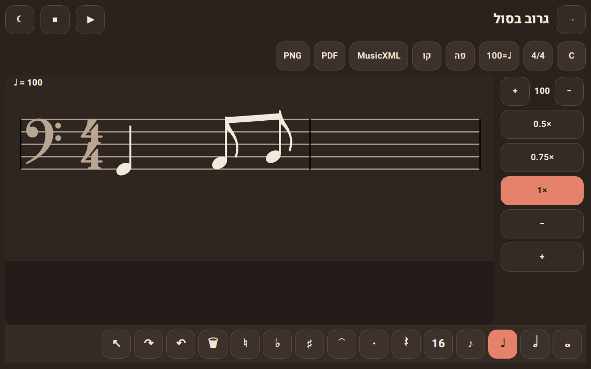

# מחברת בס

מחברת תווים לטאבלט אנדרואיד, בעברית, שעובדת לגמרי בלי אינטרנט. בוחרים משך, מקישים על החמשה, והתו נחרט מיד. אפשר לשמוע, לשמור מחברת שלמה, ולייצא ל-MusicXML, ל-PDF ול-PNG. הכול בחינם: בלי חשבון, בלי פרסומות ובלי הגבלה על מספר העמודים.

האפליקציה בנויה כאתר סטטי (בלי build) ואפשר להתקין אותה למסך הבית.

## צילומי מסך







## התקנה בטאבלט אנדרואיד

1. פותחים את האתר בכרום.
2. בתפריט ⋮ בוחרים **התקן אפליקציה** או **הוסף למסך הבית**.
3. אחרי הטעינה הראשונה אפשר לעבוד גם במצב טיסה. ההשמעה היא סינתזה מקומית, והייצוא לא צריך רשת.

## מדריך מהיר

1. **＋ רעיון חדש** — פה (ברירת מחדל), סול, או חמשה כפולה.
2. בפלטה התחתונה בוחרים משך: שלמה, חצי, רבע, שמינית, 16.
3. מקישים על קו או על רווח. התו נחרט ונשמע קצרות.
4. גוררים למעלה או למטה לפני השחרור כדי לתקן גובה.
5. ▶ מנגן מההתחלה, ⏸ עוצר, ■ חוזר להתחלה. קו הסמן זז עם הצליל.

רעיון חדש נפתח במפתח פה, במשקל 4/4, בדו מז'ור, ובטמפו ♩=100.

## מחוות וקיצורי מקלדת

| פעולה | במסך | במקלדת |
|---|---|---|
| משך | 𝅝 𝅗𝅥 ♩ ♪ 16 | `1`–`5` |
| נקודה | · (פעם, פעמיים, בלי) | `.` |
| הפסקה | 𝄽 | `R` |
| חיבור | ⁀ | `T` |
| דיאז / במול / בקר | ♯ ♭ ♮ | `+` / `-` / `N` |
| הוספת תו | הקשה על החמשה | `A`–`G` |
| גובה | גרירה, או בחירה ואז גרירה | `↑` `↓` (עם Ctrl: אוקטבה) |
| סמן | הקשה בין תווים | `←` `→` |
| מחיקה | 🗑 | Backspace |
| ביטול / שחזור | ↶ ↷, שתי אצבעות / שלוש | Ctrl+Z / Ctrl+Shift+Z |
| השמעה | ▶ ⏸ | רווח |
| תקריב | צביטה, או +/− |  |

סימן היקש (♯ ♭ ♮) בלי תו נבחר חל על ההקשה הבאה בלבד. כשתו נבחר, המשך, הנקודה והסימן חלים עליו.

## ייצוא

- **MusicXML** — קובץ שאפשר לפתוח ב-MuseScore. כולל מפתח, סולם, משקל, טמפו, חיבורים, ובחמשה כפולה גם `<backup>`.
- **PDF** — עמוד A4 עם הכותרת.
- **PNG** — תמונה רחבה (לפחות 2000 פיקסלים) על רקע נייר בהיר.

בהגדרות: הורדת גיבוי JSON, ושחזור במיזוג או בהחלפה (ההחלפה מבקשת אישור פעמיים). קובץ פגום נדחה בלי לשנות את המחברת. גיבוי ישן מגרסה 1 מתקבל, בלי שכבת העט.

**הנתונים נשמרים רק במכשיר.** אם מוחקים את האפליקציה או מנקים את נתוני האתר, היצירות נעלמות. כדאי לייצא JSON מדי פעם. אחרי שבועיים בלי גיבוי מופיעה תזכורת.

## גובה הבס

בשלב הזה הבס מושמע בגובה הכתוב (concert), בלי הנמכת אוקטבה. קו תחתון במפתח פה הוא סול 2, קו עליון הוא לה 3, ומי במפתח הראשון מתחת לחמשה הוא מי 1.

## הרצה מקומית

```bash
python3 tools/serve.py 4173
```

ואז לפתוח `http://127.0.0.1:4173/#list`.

## בדיקות

```bash
npm test
```

Playwright מריץ כרום בשלושה מסכים: מחשב 1440×900, טאבלט לרוחב 1138×712, וטאבלט לאורך 712×1138.

## רישיון וקרדיטים

הקוד של המחברת: MIT © Paul Samson.

- VexFlow 4.2.3 (MIT) וגופני Bravura 1.392 (SIL OFL 1.1)
- jsPDF 2.5.2 (MIT) ו-svg2pdf.js 2.2.4 (MIT)
- Heebo (SIL OFL 1.1)

הטקסטים המלאים נמצאים ב-[THIRD_PARTY_NOTICES.md](THIRD_PARTY_NOTICES.md). אין בקוד רישיון GPL, LGPL או CC BY-SA.
